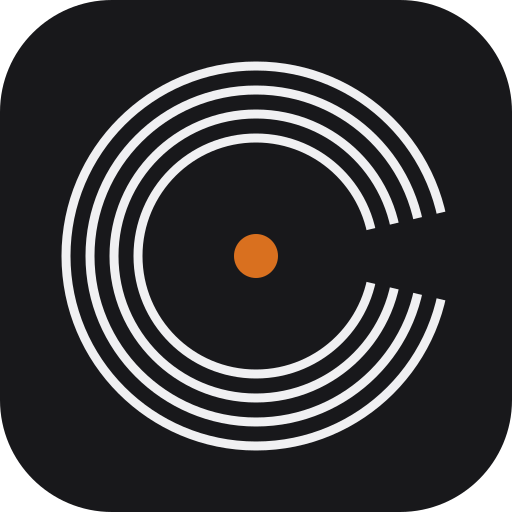

# Catalogue de la suite Labs

Vue d'ensemble pour Projet Labs (et pour chaque projet) : toutes les applis,
leurs chartes, leurs logos. Version lisible par une machine :
[`catalogue.json`](catalogue.json). À mettre à jour à chaque changement de nom,
de couleur ou de charte.

| Appli | Nom écrit | Couleur | Logo | Rôle | Charte | Thèmes |
|---|---|---|---|---|---|---|
| [Backup Labs](apps/backup-labs/README.md) | `backup.labs` | `#7ee2a8` |  | Sauvegarde tout-en-un pour Unraid (applications, Plex, dossiers, clé Unraid ; copies sur une autre machine) | complète | [thèmes](apps/backup-labs/theme.md) |
| [Plex Labs](apps/plex-labs/README.md) | `plex.labs` | `#f2b84b` |  | Gestion des visuels d'une médiathèque Plex : synchronisation des affiches, logos et backgrounds, création de covers, cartes d'épisodes et placeholders (ex-Asset Labs) | complète | [thèmes](apps/plex-labs/theme.md) |
| [Finance Labs](apps/finance-labs/README.md) | `finance.labs` | `#6cc7f0` |  | Finances personnelles du foyer, 100 % locales : import des relevés bancaires, comptes et titulaires, vue d'ensemble du patrimoine, simulateur | complète | [thèmes](apps/finance-labs/theme.md) |
| [Projet Labs](apps/projet-labs/README.md) | `projet.labs` | `#b49cff` |  | Base de connaissances Markdown versionnée, pont MCP avec Claude, restauration en un clic ; cohérence de la suite et propagation de Labs OS | complète | [thèmes](apps/projet-labs/theme.md) |
| [Torrent Labs](apps/torrent-labs/README.md) | `torrent.labs` | `#ff9b6a` |  | Recherche de torrents sur tous les indexeurs de Prowlarr, résultats en direct, envoi vers qBittorrent (ex-TorrentScope) | complète | [thèmes](apps/torrent-labs/theme.md) |
| [Dashboard Labs](apps/dashboard-labs/README.md) (en conception) | `dashboard.labs` | Lunaire `#e6edf3` (`#1b2230` sur fond clair), crochets du logo en dégradé de la suite |  | Page d'accueil et tableau de bord du quotidien (ordinateur, iPad, iPhone) : Skynet, médias, maison, journée, veille, accès rapide, avec un assistant qui agit | complète | [thèmes](apps/dashboard-labs/theme.md) |
| [Mixer Labs](apps/mixer-labs/README.md) (en conception) | `mixer.labs` | Lime `#8ef26a` (`#34791b` sur fond clair) |  | Construction de DJ sets sur timeline : on pose des morceaux de Crate et on dessine chaque transition (volume, égaliseur, filtre, effets, tempo) ; pas de mix en direct | complète | [thèmes](apps/mixer-labs/theme.md) |

Couleur réservée : rose `#f27ec6`, gardé pour un futur projet.

## Applis associées (hors suite Labs)

Applis qui ne font pas partie de la suite Labs : elles gardent leur nom, leur
logo et leur thème. Elles sont référencées ici pour avoir toutes les applis
au même endroit ; leur charte, leur logo et leurs captures sont dans leur
dossier `apps/<appli>/`.

| Appli | Nom écrit | Couleur | Logo | Rôle | Charte | Thèmes |
|---|---|---|---|---|---|---|
| [Crate](apps/crate/README.md) | `CRATE` | `#d9701f` |  | Curation et enrichissement d'une bibliothèque musicale auto-hébergée : fiches, notes, playlists, qualité des métadonnées, nouveautés des artistes suivis, téléchargements Soulseek, lecteur audio — **hors suite Labs (appli associée)** | complète | [thèmes](apps/crate/theme.md) |

## Règles communes

| Sujet | Document |
|---|---|
| **Interface commune Labs OS** (kit 2.1.0, propagé depuis Projet Labs) | [docs/labs-os.md](docs/labs-os.md), [kit/](kit/) |
| Principes | [docs/principes.md](docs/principes.md) |
| Thèmes (Labs OS + pont de chaque appli) | [docs/themes.md](docs/themes.md) |
| Couleurs | [docs/couleurs.md](docs/couleurs.md) |
| Typographie et écriture du nom | [docs/typographie.md](docs/typographie.md) |
| Composants et motifs d'interface | [docs/composants.md](docs/composants.md) |
| Vocabulaire | [docs/vocabulaire.md](docs/vocabulaire.md) |
| Logos | [docs/logos.md](docs/logos.md) |
| Icônes dans Unraid | [docs/icones-unraid.md](docs/icones-unraid.md) |
| Contribuer (déposer sa charte) | [docs/contribuer.md](docs/contribuer.md) |
| Propositions de changement | [docs/propositions.md](docs/propositions.md) |
