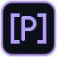

# Catalogue de la suite Labs

Vue d'ensemble pour Projet Labs (et pour chaque projet) : toutes les applis,
leurs chartes, leurs logos. Version lisible par une machine :
[`catalogue.json`](catalogue.json). À mettre à jour à chaque changement de nom,
de couleur ou de charte.

| Appli | Nom écrit | Couleur | Logo | Rôle | Charte | Thèmes |
|---|---|---|---|---|---|---|
| [Backup Labs](apps/backup-labs/README.md) | `backup.labs` | `#7ee2a8` |  | Sauvegarde tout-en-un pour Unraid (applications, Plex, dossiers, clé Unraid ; copies sur une autre machine) | complète | [thèmes](apps/backup-labs/theme.md) |
| [Asset Labs](apps/asset-labs/README.md) | `asset.labs` | `#f2b84b` |  | Curation de la bibliothèque Plex (ex-Plex Labs) | à compléter | à documenter |
| [Finance Labs](apps/finance-labs/README.md) | `finance.labs` | `#6cc7f0` |  | <à compléter> | à compléter | à documenter |
| [Projet Labs](apps/projet-labs/README.md) | `projet.labs` | `#b49cff` |  | Base de connaissances Markdown versionnée de la suite, pont MCP avec Claude, restauration en un clic ; vue d'ensemble et cohérence de la suite | complète | [thèmes](apps/projet-labs/theme.md) |
| [Torrent Labs](apps/torrent-labs/README.md) | `torrent.labs` | `#ff9b6a` |  | Recherche de torrents sur tous les indexeurs de Prowlarr, résultats en direct, envoi vers qBittorrent (ex-TorrentScope) | complète | [thèmes](apps/torrent-labs/theme.md) |

## Cohérence

Suivi tenu par Projet Labs : [apps/projet-labs/suivi.md](apps/projet-labs/suivi.md).
Propositions d'harmonisation en attente : [docs/propositions.md](docs/propositions.md).

## Règles communes

| Sujet | Document |
|---|---|
| Principes | [docs/principes.md](docs/principes.md) |
| Thèmes (chacun les siens pour l'instant) | [docs/themes.md](docs/themes.md) |
| Couleurs | [docs/couleurs.md](docs/couleurs.md) |
| Typographie et écriture du nom | [docs/typographie.md](docs/typographie.md) |
| Composants et motifs d'interface | [docs/composants.md](docs/composants.md) |
| Vocabulaire | [docs/vocabulaire.md](docs/vocabulaire.md) |
| Logos | [docs/logos.md](docs/logos.md) |
| Icônes dans Unraid | [docs/icones-unraid.md](docs/icones-unraid.md) |
| Contribuer (déposer sa charte) | [docs/contribuer.md](docs/contribuer.md) |
| Propositions de changement | [docs/propositions.md](docs/propositions.md) |
